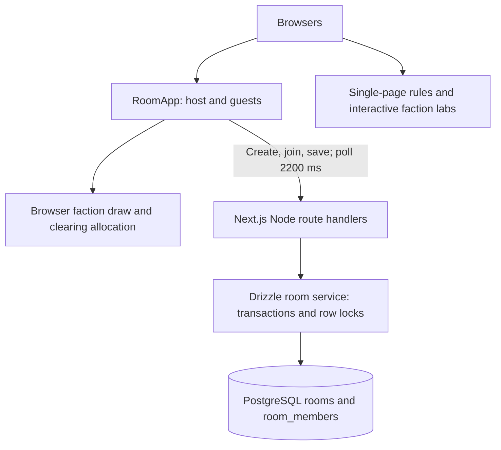

# AGENTS.md

## Project and scope

Apply this guidance throughout this repository. Root • Chia phe is a Vietnamese
Root board-game companion: shared setup rooms, QR invitations, Reach faction
assignment, clearing allocation and interactive general/faction rule tutorials.
It is not a complete game engine. Bots are synthetic assignment slots, not AI.
Read the affected code and update this guide when architecture/contracts change.

## Runtime and architecture

- Standard Next.js 16.3.4 App Router on Node >=22.13.0; React 19.2.6,
  TypeScript 5.9.3, Tailwind 4 and custom CSS. No Vinext/Cloudflare/Sites runtime.
- PostgreSQL via Drizzle 0.45.2 + Postgres.js 3.4.9. `DATABASE_URL` is required
  only for room APIs/migrations. The lazy process-local pool survives dev HMR;
  max 10 connections per process.
- Next config uses `output: "standalone"`. Docker copies public + static assets,
  runs UID 1001 on `0.0.0.0:3000`. Separate `migrator` target runs explicit SQL.
- Builds need no DB credentials. `NEXT_PUBLIC_SITE_URL` is public build-time
  metadata, never a secret. `.env` is ignored and excluded from Docker contexts.
- PostgreSQL timestamps are bigint epoch milliseconds exposed as JS numbers.
  Configuration/result stay JSON text, with empty result text meaning null.



## Source map

| Path | Responsibility |
| --- | --- |
| `app/page.tsx`, `app/room-app.tsx` | Home, guest identity, QR, polling, host controls and draws |
| `app/root-data.ts` | Canonical 13 factions, 6 maps, Reach values and thresholds |
| `app/clearing-data.ts`, `app/clearing-map.tsx` | Map coordinates and clearing suits/flood/landmarks |
| `app/layout.tsx`, `app/globals.css` | Vietnamese layout, fonts, metadata and shared styles |
| `app/api/rooms/` | Thin Node HTTP route handlers, existing API contracts |
| `db/index.ts`, `db/connection.mjs` | Lazy pool and local/remote TLS options |
| `db/rooms.ts` | Atomic creation, join/update locks and consistent snapshots |
| `db/schema.ts`, `drizzle/postgresql/` | PostgreSQL schema, generated SQL and metadata |
| `lib/room-http.ts` | Body cleaning, no-store JSON, sanitized error responses |
| `app/api/health/route.ts` | Process-only health, no DB details |
| `app/rules/` | General rules/reference, shared RuleBook and faction guide navigation |
| `app/rules/factions/<id>/` | Page, story, adventure, CSS, optional labs/model |
| `public/assets/`, `public/fonts/` | Artwork and locally hosted Be Vietnam Pro fonts |
| `public/assets/rules/sources.md` | Asset attribution and rule source notes |
| `scripts/migrate.mjs`, `scripts/start.mjs` | Explicit migrations and local standalone preview |
| `tests/rooms.test.ts`, `tests/e2e/` | Fresh local DB/concurrency and browser integration tests |

Read `README_LOCAL.md` for setup and `AZURE_DEPLOYMENT.md` for deployment.
Historical Worker/Sites configuration/scripts and SQLite migrations were removed;
there is no automatic D1 data copy or production-data connection.

## API and concurrency contracts

- POST `/api/rooms`: body hostId/displayName; response `{code}`; create room and
  host membership together in a transaction. Crypto-generated six-character
  codes use the existing alphabet. Unique PK resolves collisions; retry eight
  times, then return 503 `ROOM_CODE_EXHAUSTED`.
- GET `/api/rooms/[code]`: returns code/title/hostId/config/result/revision and
  members with snake_case member fields, ordered by joined_at. Share-lock the
  room row while reading members for a consistent snapshot.
- POST room code: userId/displayName; join or rename existing member. Update-lock
  the room before capacity/count/upsert. Existing rejoin retains timestamp and
  revision. New member clears result, clamps bots and increments revision.
- PUT room code: hostId/config, optional result. Lock room before reads/writes.
  Clamp bots to available slots, preserve latest result if omitted, clear if
  null, increment revision once and return the transaction's snapshot.
- Maintain last-serialized-writer-wins for configuration: no expectedRevision is
  required by the existing client. Locks prevent lost increments and capacity
  races; they do not reject a caller's stale explicit result/configuration.
- Preserve NAME_REQUIRED 400, ROOM_NOT_FOUND 404, ROOM_FULL 409, HOST_ONLY 403,
  CONFIG_REQUIRED 400 and no-store headers. Unexpected DB failures return
  INTERNAL_ERROR 500 with generic logs, never driver details or connection URLs.
- All user inputs use parameterized Drizzle queries. Migration `.unsafe()` runs
  only checked-in SQL, never request input. Keep creation/member writes atomic.
- Room snapshots expose hostId, and PUT accepts caller-provided hostId. This is
  the existing guest contract, not authenticated authorization. No Sites login
  or workspace access policy remains. Do not silently redesign auth in fixes.

## Client setup behavior to preserve

Guest UUID/name are stored under `root-room-user` / `root-room-name`. Invitations
are `/?room=CODE`. Clients poll every 2200 ms; no WebSockets. Host map/faction
selection is local until saving a draw or bot update. Bot slots fill up to six
participants. Assignments are in room result JSON, not member faction_id.
`leaveRoom()` resets browser state only; no membership deletion/room expiry exists.

- Minimum Reach by count: 2->17, 3->18, 4->21, 5->25, 6->28.
- Enumerate distinct enabled-faction combinations, total minimum..minimum+5.
- Two players require both military; larger groups require at least one military.
- Exclude Vagabond + Knaves of the Deepwood together.
- Weight Reach toward midpoint, select a matching combination, shuffle assignment.
- Ordinary clearing allocation: four fox, four rabbit, four mouse.
- Marsh: 15 positions; fewer than five players selects three flooded locations;
  five/six players uses three landmarks, one of each suit.

These are current app constraints, not a guarantee of official game balance.
Guides show direct Vietnamese rules on one scrollable page per faction. Shared
`app/rules/rule-book.tsx` renders every topic/rule with anchor navigation; never
hide rules behind scene/step paging or automatic playback. The legacy file names
`story.ts` and `adventure.tsx` remain: content/topics and RuleBook composition,
respectively. `labs.tsx` holds independently mounted interactive examples and
`model.ts` helpers; Cat/Eyrie have more logic inline. Demo state belongs to its
topic and does not affect other examples or persist in PostgreSQL. Preserve rule
references, simplification notes, resets, reduced motion and mobile map controls.

## Commands and checks

Use pinned pnpm 11.25.0. On PowerShell use `pnpm.cmd` if .ps1 is blocked. Do not
mix package managers or perform unrelated dependency upgrades.

```powershell
pnpm.cmd install --frozen-lockfile
# Copy/edit .env.example to .env first; use a random local password.
docker compose up -d --wait postgres
pnpm.cmd run db:migrate
pnpm.cmd run dev
pnpm.cmd run typecheck
pnpm.cmd run build
pnpm.cmd run start
pnpm.cmd run test:db
pnpm.cmd exec playwright install chromium
pnpm.cmd run test:e2e
pnpm.cmd run lint
```

- Local DB publishes loopback 5433 by default; internal port is 5432.
- `start` runs standalone, copies assets, and converts generated directory
  symlinks to junctions on Windows. Stop old preview before rebuild.
- Tests require local-only services. DB tests refuse non-loopback endpoints,
  create/drop their own random DB and require CREATEDB. Browser tests create
  rooms on their configured app; do not point TEST_BASE_URL at production.
- Migrations are explicit deployment steps, never per-replica startup. Generate
  new SQL after schema changes; do not edit applied SQL. Runner serializes deploy
  jobs with an advisory lock, checks hashes and rolls back the pending batch on
  failure. Avoid SQL that cannot run in a transaction in this workflow.
- `VALIDATION.md` records verified checks. Original UI lint baseline is 34 errors,
  79 warnings. Do not hide baseline failures with broad disables. Type/build and
  migration-related checks must pass; run affected integration/browser checks.
- Remote DB connections verify TLS certificates/hostnames; local may disable
  TLS. Do not log secrets or turn off rejectUnauthorized for connectivity fixes.

## Editing and deployment conventions

Keep UTF-8 Vietnamese accents and existing faction IDs, assets and bilingual
names. Match adjacent structure without unrelated bulk reformatting. Keep data
in root-data.ts. Treat components/ui as shared/vendored; prefer focused changes.
Check official linked rules when changing gameplay text and preserve asset/font
licenses and attribution. Do not invent official-looking component artwork.

Ignore node_modules, `.next`, `.pnpm-store`, logs, test output and `.env`. Retain
ignore entries for old `.wrangler`, `.vinext`, `.sites-runtime` and dist artifacts
left in migrated working copies. Docker secrets are runtime-only; only the
public site URL may be a build argument. Do not automatically access production,
copy production data, create paid cloud resources or deploy without authorization.
Azure publishes immutable image revisions and runs an explicit migration job;
rollback moves traffic and does not reverse the database schema.

For this checkout's Git ownership error, use command-scoped
`git -c safe.directory=E:/Learning/Root-Chia-Phe/root-chia-phe ...`, not global Git
configuration changes. Update AGENTS.md with meaningful architecture changes.

<!-- BEGIN:nextjs-agent-rules -->

# This is NOT the Next.js you know

This version has breaking changes — APIs, conventions, and file structure may all differ from your training data. Read the relevant guide in `node_modules/next/dist/docs/` (resolved from this file's directory; in monorepos the `next` package may not be visible from the repo root) before writing any code. Heed deprecation notices.

This block is written and re-added by `next dev` — verify at `node_modules/next/dist/server/lib/generate-agent-files.js`. Removing it from a diff only re-creates the uncommitted change; committing it with your work keeps the tree clean.

<!-- END:nextjs-agent-rules -->
